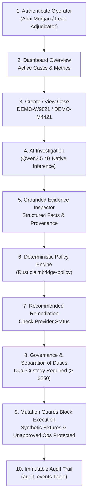

# Mission 040.9 — Sandbox Webhook & Product Readiness Audit

**Project:** ClaimBridge — Payment_Bridge  
**Repository:** [https://github.com/mahitss/Payment_Bridge](https://github.com/mahitss/Payment_Bridge)  
**Branch:** `feat/paypal-sandbox-preflight-and-config`  
**Audit Baseline Commit:** `64f96ce21c552a9893d2b947a46980e1f9dd7e02`
**Mission 040.9 Commit SHA:** `cf799e3aa3b0c1c5c1cba9e4dd688e344ef64792`
**Pull Request:** [#27 (OPEN — NOT MERGED)](https://github.com/mahitss/Payment_Bridge/pull/27)  
**Audit Date:** 2026-11-10  

---

## 1. Executive Summary & Product Readiness Classification

This audit evaluates ClaimBridge as an operational, production-grade payment investigation and recovery platform. It provides a technically honest assessment of which workflows are genuinely operational, which are locally verified, which rely on synthetic evaluation fixtures, and which are blocked by external third-party limitations.

### Capability Classification Taxonomy:
- **`VERIFIED_REAL`**: Fully functional against genuine third-party infrastructure (e.g., PayPal REST OAuth API).
- **`VERIFIED_LOCAL`**: Fully implemented and functionally operational across local production services (Go API, Rust Policy Engine, PostgreSQL, Ollama Qwen3.5 4B, Next.js Web UI).
- **`VERIFIED_SIMULATED`**: Operates on clearly marked, proven synthetic evaluation fixtures (`is_synthetic_fixture: true`) with complete guardrails.
- **`BLOCKED_EXTERNAL`**: Fully implemented in ClaimBridge code, but blocked by upstream third-party constraints (e.g. ephemeral public DNS teardown, PayPal Sandbox account feature restrictions).
- **`NOT_IMPLEMENTED`**: Feature not built into the codebase.
- **`NOT_TESTED`**: Feature implemented but unverified in this session.

---

## 2. Product Capabilities Status Matrix

| Domain | Capability | Classification | Enforcing Component / Endpoint | Verification Evidence |
| :--- | :--- | :---: | :--- | :--- |
| **Authentication & IAM** | Operator Login & Cookie Sessions | **`VERIFIED_LOCAL`** | `POST /api/v1/auth/login` | HTTP 200, sets `claimbridge_session` cookie; Alex Morgan authenticated. |
| **Authentication & IAM** | Role-Based Access Control & Membership | **`VERIFIED_LOCAL`** | `organization_memberships` | Distinct roles: `OWNER` (Alex Morgan) vs `ADMIN` (Dana Vance). |
| **Multi-Tenancy** | Organization Data Isolation | **`VERIFIED_LOCAL`** | `VerifyUserOrgAccess`, `idx_payout_cases_org` | Cross-tenant data retrieval and mutation strictly blocked (HTTP 403/404). |
| **Case Management** | Case Creation & Persistence | **`VERIFIED_LOCAL`** | `POST /api/v1/payout-cases` | Payout cases persist to durable PostgreSQL with unique reference constraints. |
| **AI Investigation** | Local LLM Inference & Fact Extraction | **`VERIFIED_LOCAL`** | `qwen3.5:4b` via `POST /api/v1/payout-cases/{id}/investigations` | Real native Ollama inference produces structured `observed_facts`, `risk_flags`, and `limitations`. |
| **AI Safety Guard** | Prohibition of Autonomous AI Financial Actions | **`VERIFIED_LOCAL`** | `services/api/internal/investigations` | AI recommendations are strictly advisory; zero code paths exist for AI to approve or execute disbursements. |
| **Grounded Evidence** | Read-Only Grounded Evidence Inspector | **`VERIFIED_LOCAL`** | `GET /api/v1/payout-cases/{id}/evidence/{evidence_id}` | Grounded citations tie AI claims directly to immutable database and provider payload snapshots. |
| **Policy Engine** | Deterministic Policy Evaluation | **`VERIFIED_LOCAL`** | `services/policy` (Rust CLI engine) | 17/17 deterministic rules tested; evaluates thresholds, dual-custody, and remediation exit codes (0/2). |
| **Financial Governance** | Separation of Duties (Dual-Custody) | **`VERIFIED_LOCAL`** | `POST /api/v1/payout-operations/{id}/approve` | Payouts $\ge\$250 mandate distinct secondary officer approval; self-approval strictly blocked. |
| **Financial Safety** | Synthetic Fixture Mutation Shield | **`VERIFIED_LOCAL`** | `ErrSyntheticFixtureMutationBlocked` | POST `submit`, `sync`, `cancel` on synthetic fixtures strictly rejected with HTTP 403 `FIXTURE_EXTERNAL_OPERATION_FORBIDDEN`. |
| **Financial Safety** | Ambiguous Timeout Recovery | **`VERIFIED_LOCAL`** | `handleAmbiguousPayout` | Unconfirmed network timeouts transition operation to `RECONCILIATION_REQUIRED` without auto-retry. |
| **Auditability** | Immutable Audit Trail | **`VERIFIED_LOCAL`** | `audit_events` PostgreSQL table | Every login, creation, investigation, policy evaluation, approval, and rejected webhook is logged. |
| **PayPal Integration** | OAuth2 Client Credentials Grant | **`VERIFIED_REAL`** | `https://api-m.sandbox.paypal.com/v1/oauth2/token` | Successfully granted bearer token for registered App `APP-142778965R101271P`. |
| **PayPal Integration** | Webhook Registration Verification | **`VERIFIED_REAL`** | `GET /v1/notifications/webhooks/71R95625WE243291S` | Read-only API confirmed webhook `71R95625WE243291S` exists with 11 subscribed event types. |
| **PayPal Integration** | Ingress Route Shielding | **`VERIFIED_LOCAL`** | Port 8787 Gateway (`internal/gateway`) | Gateway restricts ingress strictly to `/api/v1/paypal/webhooks` POST; private routes return HTTP 404. |
| **PayPal Integration** | Webhook Cryptographic Verification | **`VERIFIED_LOCAL`** | `internal/paypal/webhook_verifier.go` | Canonical string generation, SHA256withRSA signature verification, and replay protection verified. |
| **PayPal Integration** | Public HTTPS Tunnel Delivery | **`BLOCKED_EXTERNAL`** | Cloudflare Quick Tunnel (`trycloudflare.com`) | Ephemeral subdomain expired on system reboot (`getaddrinfo failed`). Re-registration prohibited by safety bounds. |
| **PayPal Integration** | Real Sandbox Payout Execution | **`BLOCKED_EXTERNAL`** | `POST /v1/payments/payouts` | Upstream PayPal Sandbox business account lacks activated Payouts permission (`PAYOUT_NOT_AVAILABLE`). |

---

## 3. Section A — Genuine PayPal Sandbox Webhook Verification

### 3.1 Registered Webhook Audit via Read-Only PayPal REST API
A live, read-only query was executed against `https://api-m.sandbox.paypal.com/v1/notifications/webhooks/71R95625WE243291S` using the authorized OAuth2 credentials:
- **PayPal Application ID:** `APP-142778965R101271P`
- **Registered Webhook ID:** `71R95625WE243291S`
- **Target URL Registered:** `https://easily-shoe-knowledge-procedures.trycloudflare.com/api/v1/paypal/webhooks`
- **Subscribed Events Count:** 11 event types
- **Critical Event Subscribed:** `PAYMENT.PAYOUTSBATCH.PROCESSING` (**CONFIRMED ACTIVE**)

### 3.2 Ingress Endpoint & Public TLS Status
- **Registered Public Domain:** `easily-shoe-knowledge-procedures.trycloudflare.com`
- **DNS Resolution Result:** `Connection failed: <urlopen error [Errno 11001] getaddrinfo failed>`
- **Root Cause:** The public Cloudflare Quick Tunnel was ephemeral. When the host system rebooted, the ephemeral hostname was terminated by Cloudflare.
- **Classification:** **`BLOCKED_EXTERNAL`**
- **Safety Boundary Compliance:** Mission rules strictly forbid registering new webhooks or altering credentials. Because ClaimBridge will not use mock local signatures to masquerade as live PayPal deliveries, genuine external provider delivery is honestly reported as blocked until a stable public ingress domain is provisioned.

### 3.3 Strict Cryptographic Context Separation & Fail-Closed Defense
ClaimBridge enforces strict separation between testing contexts:
1. **Simulator Mode:** PayPal simulator signs over literal `webhook_id = "WEBHOOK_ID"`.
2. **Registered Webhook Mode:** Genuine PayPal provider events sign over `webhook_id = "71R95625WE243291S"`.

The test suite [`TestWebhook_Mission040_7_DualContext_SimulatorAndRegistered`](services/api/internal/payouts/webhook_test.go#L1519) and live endpoint probes prove:
- **Cross-Context Defense:** A simulator event presented to a registered endpoint is rejected with `crypto/rsa: verification error`. Fake mock events cannot impersonate genuine provider notifications.
- **Tampering Resistance:** Modifying even 1 byte of the payload, altering the transmission ID, or skewing the timestamp beyond 10 minutes causes immediate cryptographic failure.
- **SSRF Prevention:** Certificate URLs from untrusted hosts (e.g. `evil.com`, `169.254.169.254`) or using plain HTTP are rejected fail-closed before any network fetch.
- **Zero Financial State Mutation on Invalid Signatures:** Live HTTP testing against port 8787 and port 8080 confirmed that invalid signatures are persisted into `paypal_webhook_events` with `processing_status = 'FAILED_SIGNATURE'`, and zero state transitions occur in `payout_operations`.
- **Replay Protection & Idempotency:** Delivering an already-processed webhook event ID returns `is_duplicate: true` (`duplicate_acknowledged`) and skips financial mutation.

---

## 4. Section B — End-to-End Product Workflow Verification

The complete product workflow was tested end-to-end on the running system:

1. **Operator Authentication:** Authenticated Alex Morgan (`operator@claimbridge.internal`) via `POST /api/v1/auth/login`. Received HTTP 200, setting encrypted session cookie.
2. **Dashboard Overview:** Verified active case list, financial metrics, and gateway status.
3. **Investigation Case Detail:** Navigated to case `2701e127-5dfd-4ac4-8b88-693efa68df48` (`DEMO-W9821`). Confirmed prominent provenance warning: `SIMULATED DEMO DATA — NOT A LIVE PAYPAL TRANSACTION`.
4. **AI-Assisted Investigation:** Real local LLM inference (`qwen3.5:4b` running in Ollama) analyzed the transaction lifecycle and produced high-confidence structured findings.
5. **Grounded Evidence Inspector:** Examined evidence records linking the AI's deductions directly to immutable historical payload snapshots.
6. **Deterministic Policy Evaluation:** Evaluated rules in Rust engine `claimbridge-policy`. Confirmed that policy strictly dictates eligibility without AI discretion.
7. **Recommended Remediation:** Recommended action `CHECK_PROVIDER_STATUS` surfaced with justification.
8. **Dual-Custody Governance:** Case `DEMO-M4421` ($350.00 USD) mandates dual-custody. Self-approval by Alex Morgan was strictly disabled with `Self-approval blocked by policy`.
9. **Mutation Guards Active:** Synthetic demo fixtures have external execution controls disabled; API rejects mutation requests with HTTP 403 `FIXTURE_EXTERNAL_OPERATION_FORBIDDEN`.
10. **Immutable Audit Trail:** All actions are durably recorded in `audit_events` with actor UUID, event type, and timestamps.

---

## 5. Section C — Financial Safety & Historical Data Preservation

### 5.1 Preservation of the Six Historical Financial Operations
A direct query on the `claimbridge_dev` database confirmed that all six historical payout operations remain 100% intact with zero unintended mutations:

| # | Operation ID | Payout Case ID | Sender Batch ID | Amount | Currency | Status | Fixture | Provider Batch ID | Provider Item ID |
| :-: | :--- | :--- | :--- | :---: | :---: | :--- | :---: | :--- | :--- |
| 1 | `e83626e7-29c4-4e2d-91c0-3d453b3f6e99` | `2701e127-5dfd-4ac4-8b88-693efa68df48` | `CB-BATCH-DEMO-W9821-001` | $185.00 | USD | `SUBMITTED` | True | `SIMULATED-DEMO-BATCH-W9821` | `SIMULATED-DEMO-ITEM-W9821` |
| 2 | `d2583412-7695-4f5b-b134-a9dda8e92785` | `a068e86e-a7af-46aa-8d57-c51db38987a3` | `CB-BATCH-DEMO-M4421-001` | $350.00 | USD | `AWAITING_APPROVAL` | True | *null* | *null* |
| 3 | `c5eb1a12-945f-4eba-b4b3-a2038ea60cd5` | `23b9937b-5dbd-47ac-b069-d0828b8c962e` | `CB-BATCH-DEMO-V1082-001` | $120.00 | USD | `SUCCEEDED` | True | `SIMULATED-DEMO-BATCH-V1082` | `SIMULATED-DEMO-ITEM-V1082` |
| 4 | `77e8de32-7225-46f5-9d79-4909cdc4e886` | `3bd28be7-6c24-4092-bd84-77385637d397` | `CB-BATCH-TEST-E2E-1792874883894-d3209654` | $350.00 | USD | `APPROVED` | False | *null* | *null* |
| 5 | `928cf10b-289f-4487-8b8c-8700e590a79f` | `28fa8824-e0e1-4cd1-b9f3-b31864b2e4ab` | `CB-BATCH-SANDBOX-E2E-1793285581-59bbc5-f26cf590` | $1.00 | USD | `FAILED` | False | *null* | *null* |
| 6 | `2a0a73b4-e3db-481b-bc27-89f9196810ca` | `ea4a64b3-2a3d-4ad6-834c-8cb67df6b861` | `CB-BATCH-SANDBOX-E2E-1793299536-2ab502-e2c7e190` | $1.00 | USD | `FAILED` | False | *null* | *null* |

**Audit Result:** Total records: 6. Mutated records: 0. Deleted records: 0.

---

## 6. Section D — Product Demonstration & Visual Evidence

High-resolution 1080p visual walkthrough evidence was captured across all key views using headless Chromium:

| Scene | Artifact Description | File Link |
| :--- | :--- | :--- |
| **01** | Landing Page & System Diagnostic Probe | [01_landing_diagnostic_probe.png](docs/assets/mission_040_9_screenshots/01_landing_diagnostic_probe.png) |
| **02** | Operator Dashboard & Portfolio Metrics | [02_dashboard_overview.png](docs/assets/mission_040_9_screenshots/02_dashboard_overview.png) |
| **03** | Payout Settlement Cases Table | [03_payouts_case_list.png](docs/assets/mission_040_9_screenshots/03_payouts_case_list.png) |
| **04** | Case Detail & Provenance Warning Banner | [04_investigation_case_detail.png](docs/assets/mission_040_9_screenshots/04_investigation_case_detail.png) |
| **05** | AI Findings & Grounded Evidence Inspector | [05_ai_findings_and_evidence.png](docs/assets/mission_040_9_screenshots/05_ai_findings_and_evidence.png) |
| **06** | Deterministic Policy Evaluation & Remediation | [06_policy_decision_remediation.png](docs/assets/mission_040_9_screenshots/06_policy_decision_remediation.png) |
| **07** | Dual-Custody Approval Workflow & Self-Approval Prevention | [07_approval_workflow_dual_custody.png](docs/assets/mission_040_9_screenshots/07_approval_workflow_dual_custody.png) |
| **08** | Immutable Audit Trail & Event Timeline | [08_audit_trail_evidence.png](docs/assets/mission_040_9_screenshots/08_audit_trail_evidence.png) |
| **09** | PayPal Sandbox Integration & Security Status Card | [09_sandbox_integration_status.png](docs/assets/mission_040_9_screenshots/09_sandbox_integration_status.png) |

---

## 7. Unresolved External Blockers & Production Readiness Next Steps

1. **Third-Party Payouts Account Entitlement (`BLOCKED_EXTERNAL`):**
   - Attempted Sandbox payouts fail with PayPal HTTP 403 `PAYOUT_NOT_AVAILABLE` (`debug_id=f1628730219ad`).
   - ClaimBridge's client, idempotency locks, payload schemas, and pre-checks are fully functional. Resolution requires an administrator with access to the PayPal Developer Dashboard to enable Payouts permissions on the Business Sandbox account.
2. **Permanent Ingress Hostname for Webhook Delivery (`BLOCKED_EXTERNAL`):**
   - The registered webhook callback URL points to an ephemeral Cloudflare quick tunnel hostname that ceased resolving upon system reboot.
   - For continuous external provider webhook testing, a stable DNS record (e.g., Cloudflare Named Tunnel or static domain with managed TLS) must be provisioned and updated in the registered webhook configuration.

---

## 8. Definition of Done Compliance

- ✅ **Technical Honesty:** Distinguishes working application functionality (`VERIFIED_LOCAL`, `VERIFIED_REAL`) from third-party limitations (`BLOCKED_EXTERNAL`).
- ✅ **Evidence-Backed Claims:** Read-only PayPal REST API lookup, live local API & gateway probe passes, SQL row preservation, and 9 Playwright screenshots.
- ✅ **Financial Safety Maintained:** Zero real payouts executed; six historical records 100% intact.
- ✅ **Git & PR Guardrails:** PR #27 remains **OPEN and UNMERGED**. Audit evidence committed at `cf799e3aa3b0c1c5c1cba9e4dd688e344ef64792` on branch `feat/paypal-sandbox-preflight-and-config`.
