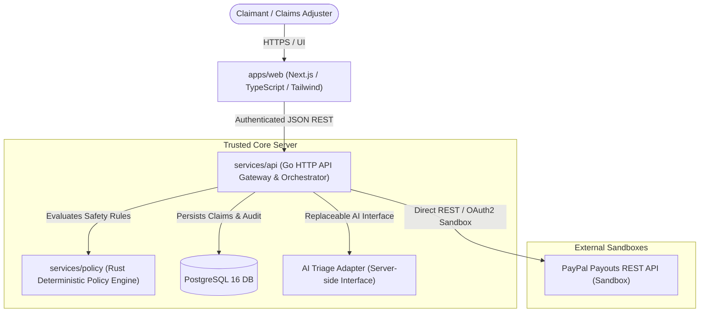

# ClaimBridge — Architecture & System Specification

## 1. System Overview & Component Responsibilities



### Component Breakdown

1. **`apps/web` (Next.js, TypeScript, Tailwind CSS, shadcn/ui)**
   - Client presentation layer for claimants submitting details and adjusters reviewing triage.
   - **Zero Secret Access**: The client never receives PayPal Client Secrets, PayPal Bearer Tokens, or internal encryption keys.
   - All state mutations are dispatched to `services/api`.

2. **`services/api` (Go 1.27 HTTP API)**
   - Primary backend orchestrator and trusted boundary.
   - Manages relational state in PostgreSQL.
   - Orchestrates the claim lifecycle: Intake -> AI Triage -> Rust Policy Verification -> PayPal Disbursement.
   - Encapsulates the PayPal Sandbox REST client with OAuth2 token caching, strict redaction, request timeouts, and zero-blind-retry semantics.

3. **`services/policy` (Rust Deterministic Policy Engine)**
   - Isolated, high-assurance policy evaluation engine.
   - Enforces business and regulatory safety invariants:
     - Maximum payout limits per claim and per 24-hour period.
     - Mandated human dual-approval triggers (> $250.00 or high risk).
     - State machine transition validity (e.g. payout cannot be initiated unless in `APPROVED` state).
     - Allowed currency and recipient format checks.
   - Operates **purely deterministically** with no external network or clock side-effects during rule evaluation.
   - Adheres strictly to **fail-closed** semantics: any ambiguous input yields an immediate `DENIED` or `ESCALATED` result with explicit violation codes.

4. **`infra`**
   - Local and deployment configuration including Docker Compose for PostgreSQL 16.

---

## 2. Trust Boundaries & Security Enclaves

| Boundary | Ingress | Egress | Trust Level | Security Controls |
|---|---|---|---|---|
| **Boundary 1: Web Client <-> Go API** | Public internet / TLS | Go API Endpoints | Untrusted -> Trusted | Rate limiting, input validation, bearer session auth, CORS. |
| **Boundary 2: Go API <-> Rust Policy Engine** | In-process / IPC | Policy Evaluation Result | Trusted -> High-Assurance | Type-safe JSON schemas, bounded inputs, memory safety. |
| **Boundary 3: Go API <-> PostgreSQL** | Private Network | SQL queries | Trusted -> Trusted | Parameterized queries, least-privilege connection user. |
| **Boundary 4: Go API <-> PayPal Sandbox** | Outbound HTTPS | PayPal REST API | Trusted -> External Sandbox | TLS 1.3, OAuth2 Client Credentials, Bearer token redaction, explicit timeouts. |

---

## 3. Data Ownership Matrix

| Data Domain | Authoritative Owner | Read Replicas / Consumers |
|---|---|---|
| **Claim Lifecycle State** | `services/api` (PostgreSQL) | `apps/web` |
| **Safety Invariants & Rules** | `services/policy` (Rust crate) | `services/api` |
| **AI Triage Scores & Rationales** | AI Provider Adapter via `services/api` | `services/policy`, `apps/web` |
| **Financial Disbursement Ledger** | PayPal Payouts API | `services/api` (`payout_records` cache) |
| **Immutable Audit Trail** | `services/api` (`audit_logs`) | Compliance & Security Monitoring |

---

## 4. API Contracts

### 4.1 Internal API (`services/api`)

#### Health & Readiness
- `GET /healthz` -> Returns `200 OK` `{ "status": "ok", "time": "..." }`
- `GET /readyz` -> Returns `200 OK` `{ "status": "ready", "db": "connected", "paypal_sandbox": "configured" }`

#### Policy Evaluation (`POST /api/v1/policy/evaluate`)
- **Request**:
  ```json
  {
    "claim_id": "c7a6e1d2-...",
    "amount_cents": 15000,
    "currency": "USD",
    "claimant_email": "user@example.com",
    "risk_score": 12.5,
    "current_state": "AwaitingPolicyCheck"
  }
  ```
- **Response**:
  ```json
  {
    "claim_id": "c7a6e1d2-...",
    "decision": "Approved",
    "requires_dual_approval": false,
    "violations": [],
    "allowed_next_states": ["Approved", "PayoutScheduled"]
  }
  ```

#### PayPal Sandbox Smoke Verification (`GET /api/v1/sandbox/verify`)
- Validates OAuth credentials against `https://api-m.sandbox.paypal.com`.
- Redacts token in response; reports connectivity, token expiration, and sandbox target.

---

## 5. Error-Handling & Idempotency Rules

1. **Zero Blind Retries on Mutation**:
   - If a `POST /v1/payments/payouts` call times out, encounters HTTP 5xx, or disconnects before a response is received, the system **MUST NOT** generate a new `sender_batch_id` and retry.
   - The system transitions the payout record to `PENDING_RECONCILIATION` and queries `GET /v1/payments/payouts/{payout_batch_id}` using the deterministic batch ID until definite settlement status is returned.
2. **Deterministic Sender Batch IDs**:
   - `sender_batch_id = "claimbridge-claim-" + claim_id` (globally unique and persistent).
3. **Structured Redacted Logging**:
   - Tokens matching `Bearer [A-Za-z0-9._-]+` or PayPal client secrets are filtered by a stream sanitizer before output.
