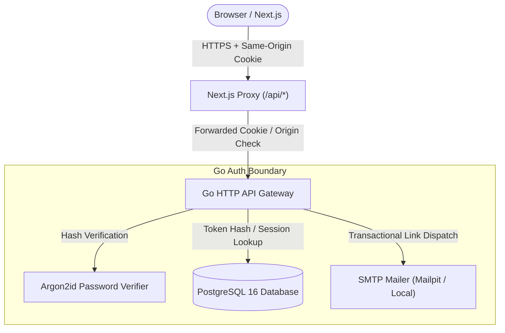

# ClaimBridge — Authentication, Session Management, and Multi-Tenancy Architecture

## 1. Overview & Trust Model

ClaimBridge is a security-conscious financial orchestration platform. Authentication must defend against credential stuffing, account enumeration, session hijacking, cross-site request forgery (CSRF), and multi-tenant data leakage.

---

## 2. Core Security Invariants

### 2.1 Password Security (Argon2id)
- **Algorithm**: Argon2id (`v=19`, `m=65536` [64 MiB], `t=3`, `p=4`, 32-byte cryptographically secure salt, 32-byte key).
- In tests, memory cost is scaled to `m=32768` (32 MiB) with `t=1` to optimize execution speed while preserving constant-time verification.
- **Timing Attack Mitigation**: When login fails due to an unknown email, a dummy Argon2id hash is verified against the input password to ensure constant-time response and eliminate account enumeration.

### 2.2 Opaque Token Security (Sessions, Verification, Password Reset)
- Tokens issued to the client are 32 cryptographically random bytes (`crypto/rand`) encoded using URL-safe base64.
- **Never Store Plaintext Tokens**: The database stores only the **SHA-256 hex hash** of tokens.
- Even with full database read access, an adversary cannot impersonate active sessions or redeem verification/reset links.
- **Single-Use Enforcement**: Tokens are consumed inside a database transaction (`consumed_at = NOW() WHERE consumed_at IS NULL`). Repeated requests are rejected.
- **Session Revocation**: A successful password reset immediately invalidates all existing active sessions for that user.

### 2.3 Session Cookie Hygiene
- **Cookie Attributes**:
  - `HttpOnly`: Strictly true (inaccessible to JavaScript; immune to XSS token theft).
  - `SameSite`: `Lax` (blocks cross-site tracking and CSRF on external navigation).
  - `Secure`: True in production (`https`); conditional in local development (`http://localhost`).
  - `Path`: `/`.
  - `Max-Age`: 72 hours (sliding window refreshed on user activity).
  - Name: `__Host-claimbridge_session` in production; `claimbridge_session` in local development.
- **Zero LocalStorage**: Tokens are NEVER written to `localStorage` or `sessionStorage`.

### 2.4 Origin & CSRF Defense
- Non-idempotent HTTP methods (`POST`, `PUT`, `DELETE`, `PATCH`) must validate the `Origin` header against an explicit list of allowed origins (`http://localhost:3000`, production domain).
- Cross-origin requests from unapproved domains are rejected with `403 Forbidden`.
- Same-origin proxy rewrites in Next.js (`/api/* -> http://localhost:8080/api/*`) ensure browser requests originate from the same host and port.

### 2.5 Multi-Tenant Organization Isolation
- Every user belongs to one or more **Organizations**.
- Upon registration, a personal organization is provisioned automatically with `is_personal = true`.
- Membership is enforced via `organization_memberships` (`organization_id`, `user_id`, `role`).
- Every claim, policy evaluation, and payout is keyed by `organization_id`.
- The database enforces uniqueness on `(organization_id, user_id)` preventing duplicate memberships.
- Queries require explicit `WHERE organization_id = $1` filters bound to the authenticated user's active session organization.

---

## 3. Data Dictionary

| Table | Key Constraints | Purpose |
|---|---|---|
| `users` | `email UNIQUE NOT NULL`, `password_hash NOT NULL` | Master user record with normalized email and Argon2id hash. |
| `organizations` | `slug UNIQUE NOT NULL` | Multi-tenant tenant boundary. |
| `organization_memberships` | `UNIQUE(organization_id, user_id)`, Foreign keys cascade on delete | RBAC relationship between user and organization. |
| `sessions` | `token_hash UNIQUE NOT NULL`, `expires_at > NOW()` | Active server-side sessions with client metadata. |
| `email_verification_tokens` | `token_hash UNIQUE NOT NULL`, single-use transactional | 24-hour expiration token for onboarding. |
| `password_reset_tokens` | `token_hash UNIQUE NOT NULL`, single-use transactional | 30-minute expiration token for credential recovery. |
| `audit_events` | Append-only, indexed on `user_id`, `organization_id`, `created_at` | Immutable ledger of authentication and privilege changes. |
